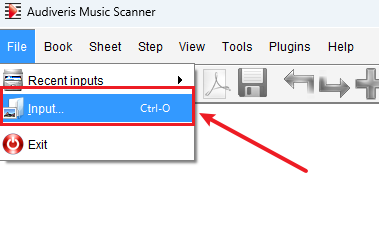
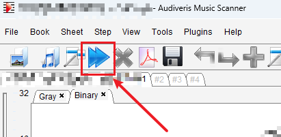
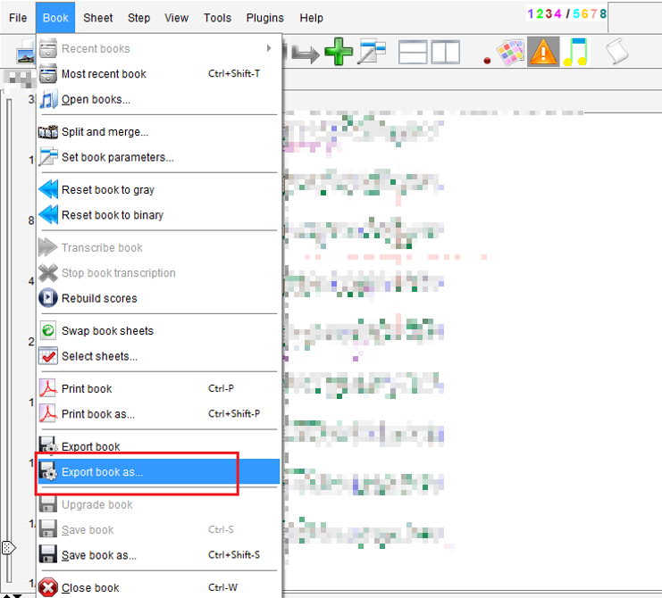

# mxl2jianpu

把**印刷谱 PDF** 和它的**OCR 结果 MusicXML**，变成一份**经 AI 对照原谱核对、修正过的简谱 PDF**（附五线谱对照版）。

OCR 软件（Audiveris、PhotoScore、SmartScore 等）识别出来的 MusicXML 看着像谱，但小节经常对不上——拍号认错、休止符漏掉、小节号重复。直接转换只会得到一份看起来合理、实际错误的谱子。

这个仓库做的事：**让能看图的模型先去看印刷谱，逐小节核对 OCR 结果，再带着证据修正，最后排版出简谱。**

---

## 它是给 Agent 用的

这个仓库的主体不是给人手动敲命令的脚本，而是**给 Agent 的一套技能与工具**：

```
.agents/skills/mxl2jianpu/
├── SKILL.md      工作流程与约束（Agent 加载这个）
└── PROMPTS.md    可直接复用的提示词
AGENT.md          给 Agent 的操作手册：环境、平台、顺序、禁区
mxl2jianpu/       工具：渲染页面、诊断、修复、排版、比对
```

你不需要手动安装和敲命令——把这些交给 Agent，它会读 `AGENT.md` 自己准备环境、加载技能、按流程执行。

**你只需要做两件事：**

1. 提供 `score.pdf`（印刷谱）和 `score.mxl`（OCR 结果）；
2. 用的是一个**支持视觉**的模型。

---

## 需要什么样的环境

Agent 会自己检查这些，这里列出来供你判断可行性：

| 组件 | 说明 |
|---|---|
| **多模态模型** | 硬性要求。流程核心是把 PDF 渲染成图片与 OCR 结果对照，纯文本模型做不了 |
| Agent 平台 | 任何能执行 shell、支持视觉的 Agent。已验证 **DeepSeek Harness** |
| Python 3.10+ | 工具本体 |
| LilyPond 2.24+ | 排版引擎，唯一需要单独安装的外部程序 |
| PyMuPDF 或 pypdfium2 | 把 PDF 渲染成图片给模型看 |

jianpu-ly 已内置在 `mxl2jianpu/vendor/`，无需另外安装。

---

## 先决一步：OCR 五线谱，得到 MXL

本工具需要两个输入，其中 **MXL 是 OCR 软件的产物**。如果你手上只有印刷谱 PDF，先用
[Audiveris](https://github.com/Audiveris/audiveris) 把它识别出来。

- 项目主页：<https://github.com/Audiveris/audiveris>
- 下载安装包：<https://github.com/Audiveris/audiveris/releases/latest>
  （本文截图基于 **5.11.0**，Windows / macOS / Ubuntu 均有安装包）
- 使用文档：<https://audiveris.github.io/audiveris>

### 操作步骤

**① 打开 PDF**

`File` → `Input...`（快捷键 `Ctrl+O`），选择印刷谱 PDF。



**② 运行识别**

点击工具栏的蓝色三角按钮，Audiveris 开始把扫描图像识别成乐谱。页数多时需要等一会儿，
识别完成后每页会生成一个 Book。



**③ 导出为 MXL**

识别完成后，`Book` → `Export book as...`。



在弹出的保存对话框里，把**文件类型选为 `MXL`**，保存。

> 这一步的对话框没有截图。唯一的要点是：**导出格式必须是 MXL**，得到 `.mxl` 文件——
> 它就是本工具的输入。导成 PDF 或图片都没用。

### 这一步的产物为什么「一定是错的」

Audiveris 是识别引擎，不是校对工具。对清晰的印刷谱它识别率不错，但会稳定地在这些地方出错：

- **拍号认错**：尤其 6/8 被当成 4/4，于是该段每一小节都少一拍；
- **漏掉休止符**：个别小节凭空短了半拍；
- **连音误判**：把连音当成普通音符，或把普通音符当成连音；
- **小节号重复**、把一个和弦拆成两个声部。

关键在于：这些错误**不会让导出的文件报错**——文件内部是自洽的，任何文件层面的检查都发现不了。
所以本工具的设计前提是：**把 OCR 结果当作待核对的证据，而不是待完善的草稿**，
用印刷谱 PDF 作为唯一权威，逐小节核对。

这正是下一步要做的事。

---

## 怎么用

### 1. 把仓库交给 Agent

克隆本仓库，把两个输入文件放进工作目录：

```
score.pdf      印刷谱，唯一权威
score.mxl      OCR 结果，待核对
```

### 2. 给 Agent 这段提示词

> 我在工作目录里给你两个文件：
> - `score.pdf` —— 印刷谱的扫描件，这是**唯一权威**；
> - `score.mxl` —— OCR 软件识别出来的 MusicXML，**一定是错的**，只是错在哪儿还不知道。
>
> 请先用 `AGENT.md` 检查环境、加载 `mxl2jianpu` 技能，然后：
>
> 1. **先看谱**。把 PDF 渲染成图片，看清拍号、调号、段落、标题栏。
> 2. **不要臆想**。OCR 和谱面不一致时以谱面为准；谱面看不清就说"不确定"，不要猜。
> 3. 每一处对 OCR 的修改都要给出 `--evidence`，写明第几页、看到什么。
> 4. 交付前两件事必须都成立：每小节拍数正确、音高与原始 MXL 一致。
> 5. 最后告诉我成品 PDF 和 `changes.json` 的位置，并逐条说明改了什么、依据是什么。
>
> 只交付你核对过的内容。看不清的部分列出来，不要悄悄跳过。

### 3. 验收

Agent 交付时应当给出两个校验数字：

```
校验   : bars off 0 / 186 ; 音高差异 0 / 186
未定   : 无
交付   : out/曲名.jianpu.pdf, out/曲名.staff.pdf, out/changes.json
```

只要这两个数字不是 0，就还不是最终成果。

---

## 产物

| 文件 | 内容 |
|---|---|
| `曲名.jianpu.pdf` | 纯简谱 |
| `曲名.staff.pdf` | 简谱 + 五线谱对照 |
| `changes.json` | 每一处对 OCR 的修改，含页码与依据 |

---

## 为什么可以信任它的输出

工具在机制上约束模型，而不是靠自觉：

**改任何东西都必须给证据。** 对 OCR 的每一处覆盖都要带 `--evidence 类型=小节=页码=看到了什么`。缺少证据时命令**直接拒绝执行**并指出是哪一条：

```
these overrides have no --evidence entry: 89
Add --evidence TYPE=BARS=PAGE=WHAT, describing what the printed page shows.
A change without evidence is a guess.
```

**两重独立校验。** 每小节拍数是否正确、每小节音高是否与原始 MXL 一致——两者会以不同方式失败，都必须通过。曾经出现过拍数全对、PDF 好看，但 7 个小节的五线谱少了一个持续音的情况，只有音高校验能发现。

**不猜。** 工具不会猜拍号（6/8 被认成 4/4 时文件内部完全自洽，任何文件层面的检查都发现不了），不会编标题，不会在合并声部时静默丢音。

---

## 文档

| 读者 | 文件 |
|---|---|
| **Agent** | [`AGENT.md`](AGENT.md) — 环境、平台、执行顺序、禁止事项 |
| Agent | [`.agents/skills/mxl2jianpu/SKILL.md`](.agents/skills/mxl2jianpu/SKILL.md) — 完整流程与判断依据 |
| Agent | [`.agents/skills/mxl2jianpu/PROMPTS.md`](.agents/skills/mxl2jianpu/PROMPTS.md) — 分步提示词 |
| 人类 | [`mxl2jianpu/README.md`](mxl2jianpu/README.md) — 工具参考 |
| 人类 | [`mxl2jianpu/docs/USAGE.md`](mxl2jianpu/docs/USAGE.md) — 一次完整实操记录 |

---

## 开发

改动代码后，先跑一次冒烟测试确认渲染链路仍然通畅：

```
python mxl2jianpu/scripts/smoke_test.py     # 期望 SMOKE PASS
```

它用一行手写的简谱走完 jianpu-ly → LilyPond → PDF，不需要任何乐谱文件。

处理真实乐谱时，还有两个校验脚本可以随时查问题：

```
python mxl2jianpu/scripts/check_bars.py out/曲名.musicxml
python mxl2jianpu/scripts/verify_pitches.py 原谱.mxl out/曲名.musicxml
```

---

## 许可

本仓库以 [Apache License 2.0](LICENSE) 发布。

`mxl2jianpu/vendor/jianpu-ly/` 来自 [ssb22/jianpu-ly](https://github.com/ssb22/jianpu-ly)，同样遵循 Apache 2.0，其原始 LICENSE 保留在该目录下。
